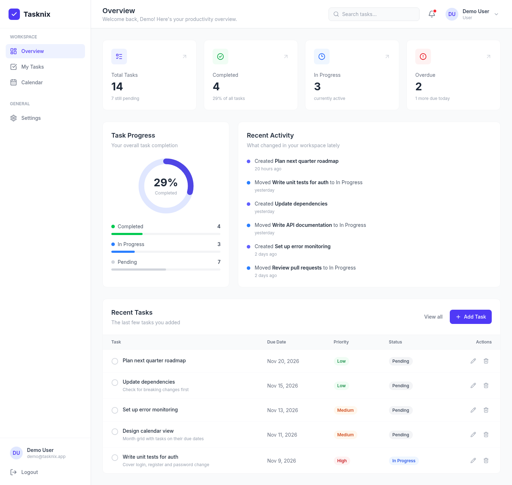
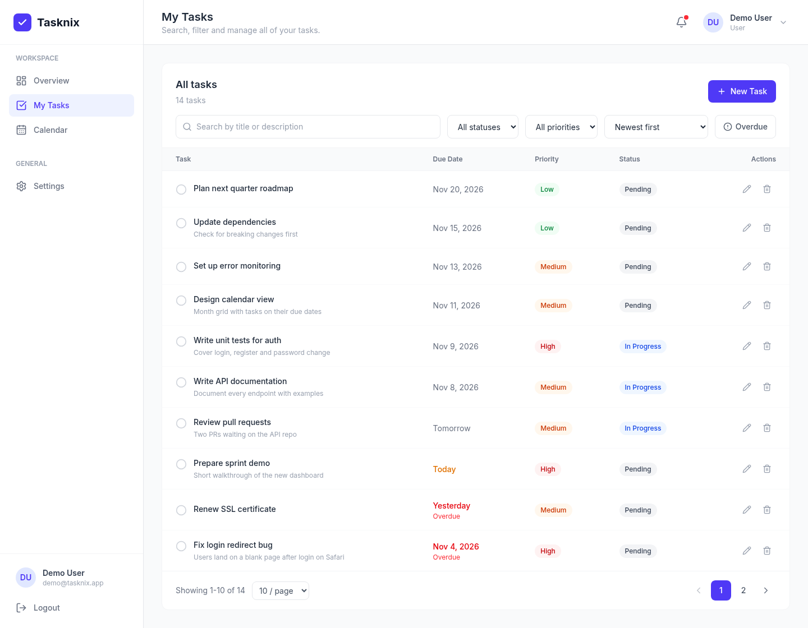
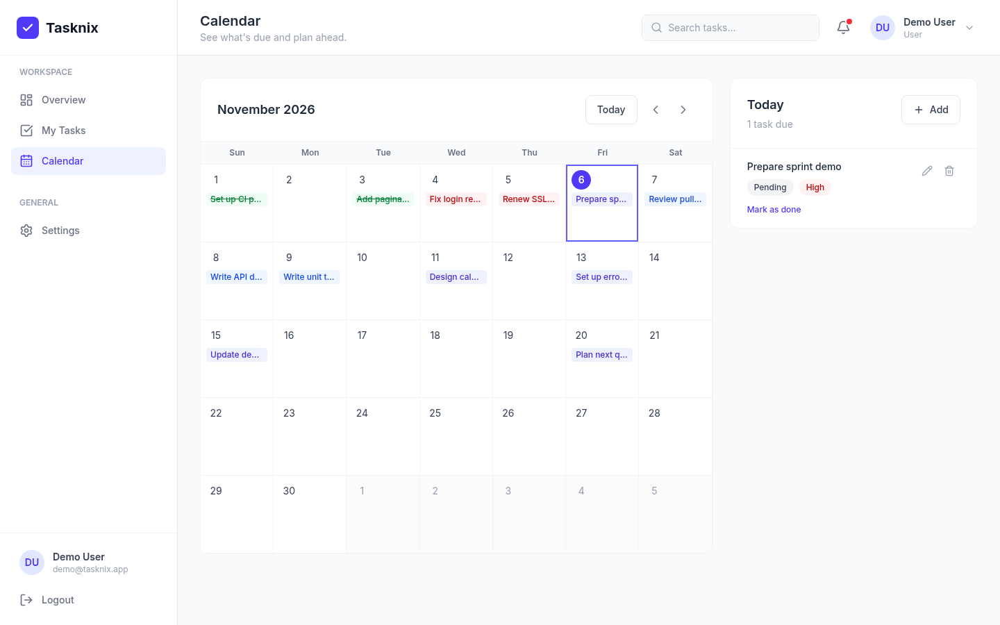
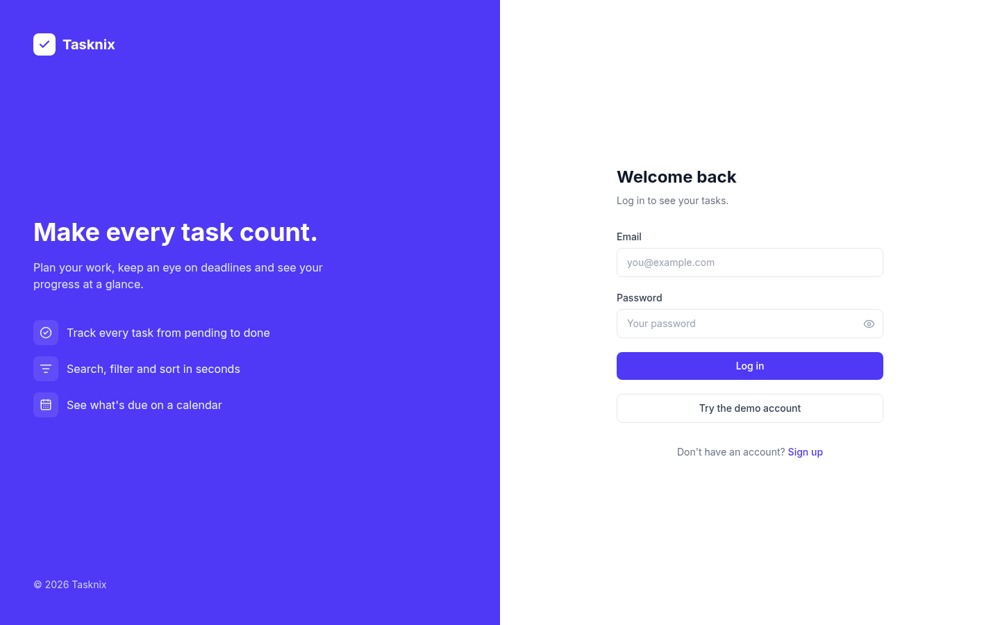
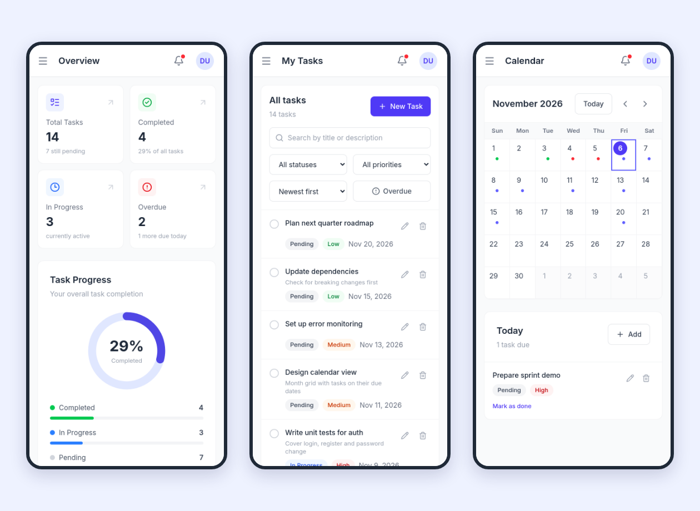
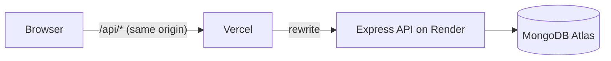

# Tasknix

A full-stack task manager built with React, Redux Toolkit, Node.js, Express and MongoDB.

You can sign up, keep track of your own tasks, search and filter them, see what's overdue, plan on a calendar and follow your progress on a dashboard.

**Live demo:** _coming soon_ &nbsp;·&nbsp; **Demo login:** `demo@tasknix.app` / `demo1234`



## Features

- **Accounts**: register, log in/out, edit your profile, change your password (this also signs out your other sessions)
- **Tasks**: create, edit and delete (with a confirmation step), or mark a task as done with one click
- **My Tasks**: search, filter by status/priority/overdue, sort, and paginate on the server
- **Calendar**: month view of tasks by due date; pick a day to see its tasks or add one to it
- **Dashboard**: task counts, a completion chart, a recent activity feed and overdue / due today notifications
- **Responsive**: on small screens the sidebar becomes a drawer and the task table turns into cards
- Loading skeletons, empty states, error states with retry, and toast messages

## Tech stack

| Part | Tools |
| ---- | ----- |
| Frontend | React 19, Vite, Tailwind CSS 4, Redux Toolkit, React Router, Axios |
| Backend | Node.js, Express 5, Mongoose 9, Zod |
| Auth | JWT in an httpOnly cookie, bcrypt |
| Testing | `node:test` + Supertest (API), Vitest + Testing Library (UI) |
| Tooling | pnpm, ESLint, Prettier, GitHub Actions |
| Hosting | Vercel (UI), Render (API), MongoDB Atlas |

## Screenshots

| My Tasks | Calendar |
| -------- | -------- |
|  |  |

| Login | Mobile |
| ----- | ------ |
|  |  |

## How it works



In development the Vite dev server proxies `/api` to the local API, so it works the same way.

A few things I did on purpose:

- The JWT lives in an httpOnly cookie instead of localStorage, so injected JavaScript can't read it. The cookie is `SameSite=Lax` and the API only accepts JSON, so I didn't add a CSRF token. Since the frontend proxies `/api`, the cookie is first-party and Safari doesn't block it.
- Every task query filters by the owner's id. Someone else's task gets the same `404` as a task that doesn't exist.
- Requests go through Zod schemas before they reach a controller, and controllers only use the parsed values. Request bodies are strict, so sending something like `user` or `role` gets a `400`. Query strings and ids are checked too (unknown query params are just ignored), and the Mongoose schemas validate again on save.
- Each token carries the user's `tokenVersion`. Changing the password bumps it, which logs out every other session.
- Login attempts are limited per IP and per account, so faking `X-Forwarded-For` doesn't help with password guessing.
- The demo account's profile and password are locked, and its tasks reset whenever the free Render instance wakes up.
- Due dates are calendar days stored as midnight UTC. The client sends its own date for the overdue checks, so they match the user's timezone.
- In Redux each list remembers its latest request id and drops older responses, and effects abort requests that aren't needed anymore. Any create/update/delete bumps a `version` counter and the page you're on refetches.
- Activity has its own collection with a 90-day TTL index, so the feed still makes sense after a task is deleted.

## Running it locally

You need Node.js 22 (see `.nvmrc`), pnpm and a local MongoDB.

```bash
git clone https://github.com/ranjith910/task-manager-fullstack.git
cd task-manager-fullstack

# API
cd backend
cp .env.example .env      # then set JWT_SECRET
pnpm install
pnpm seed                 # optional: demo account with sample tasks
pnpm dev                  # http://localhost:5000

# UI, in a second terminal
cd frontend
pnpm install
pnpm dev                  # http://localhost:5173
```

To show the "Try the demo account" button on the login page, copy `frontend/.env.example` to `frontend/.env.local` and uncomment the demo variables.

### Scripts

| Folder | Command | What it does |
| ------ | ------- | ------------ |
| backend | `pnpm dev` | API with auto reload (nodemon) |
| backend | `pnpm start` | API for production |
| backend | `pnpm seed` | Create or reset the demo account |
| backend | `pnpm test` | Integration tests (needs MongoDB running) |
| backend | `pnpm lint` | ESLint |
| frontend | `pnpm dev` | Vite dev server |
| frontend | `pnpm build` | Production build into `dist/` |
| frontend | `pnpm test` | Unit and component tests |
| frontend | `pnpm lint` | ESLint |

## Tests

- **API**: integration tests that send real HTTP requests through Supertest and hit a real MongoDB. They cover auth, validation, filters/sorting/pagination, stats, the activity log, rate limits, the demo account and that one user can't read or change another user's tasks. Each test file creates its own temporary database and drops it afterwards.
- **UI**: Vitest + Testing Library tests for the task form, the login page, route guards, the Redux slices (including the stale-response check and the session check) and the date helpers.
- GitHub Actions runs lint and tests for both apps, plus the frontend build, on pushes to `main` and on pull requests.

## Project structure

```
backend/
  src/
    config/        env validation, db connection
    controllers/   route handlers
    middleware/    auth, validation, errors, rate limits
    models/        User, Task, Activity
    routes/
    services/      activity logging, demo account reset
    utils/
    validators/    zod schemas
    app.js         express app (used by the tests)
    server.js      starts the server
  scripts/seed.js
  tests/
frontend/
  src/
    components/    layout, tasks, dashboard, auth, ui
    hooks/
    pages/         Dashboard, MyTasks, Calendar, Settings, Login, Register
    redux/         store and slices (auth, tasks, activity)
    services/      axios instance and API calls
    utils/
docs/              API reference, deployment guide, screenshots
```

## API

| Method | Endpoint | Description |
| ------ | -------- | ----------- |
| POST | `/api/auth/register` | Create an account |
| POST | `/api/auth/login` | Log in |
| POST | `/api/auth/logout` | Log out |
| GET | `/api/auth/me` | Current user |
| PATCH | `/api/auth/me` | Update name / email |
| PATCH | `/api/auth/password` | Change password |
| GET | `/api/tasks` | List tasks (search, filters, sort, pagination) |
| GET | `/api/tasks/stats` | Dashboard counts |
| POST | `/api/tasks` | Create a task |
| GET | `/api/tasks/:id` | Get a task |
| PATCH | `/api/tasks/:id` | Update a task |
| DELETE | `/api/tasks/:id` | Delete a task |
| GET | `/api/activity` | Recent activity |

Request and response examples are in [docs/API.md](docs/API.md), and there's a [Postman collection](docs/Tasknix.postman_collection.json) you can import.

## Deployment

Step-by-step instructions for MongoDB Atlas, Render and Vercel are in [docs/DEPLOYMENT.md](docs/DEPLOYMENT.md).

## Ideas for later

- Shared team workspaces and an admin view (users already have a `role` field)
- Email verification and password reset
- Drag and drop tasks between days on the calendar
- Subtasks and labels
